# Entity-Relationship Model

This document describes the Entity-Relationship (ER) model, schema, and database structure for the **TripSplit** application[cite: 1].

---

## 1. Entities and Attributes

* **`users`**: `id` (PK), `name`, `email` (unique), `password_hash`, `created_at`[cite: 8].
* **`trips`**: `id` (PK), `name`, `destination`, `start_date`, `end_date`, `total_budget` (DECIMAL), `organizer_id` (FK $\rightarrow$ `users`), `invite_code`, `created_at`[cite: 8].
* **`trip_participants`**: `id` (PK), `trip_id` (FK $\rightarrow$ `trips`), `user_id` (FK $\rightarrow$ `users`), `role` (`organizer` | `participant`), `joined_at`. Unique constraint on `(trip_id, user_id)`[cite: 8].
* **`activities`**: `id` (PK), `trip_id` (FK $\rightarrow$ `trips`), `title`, `description`, `location`, `date`, `time`, `created_by` (FK $\rightarrow$ `users`)[cite: 8, 10].
* **`expenses`**: `id` (PK), `trip_id` (FK $\rightarrow$ `trips`), `description`, `amount` (DECIMAL), `category` (`lodging` | `transport` | `food` | `other`), `date`, `paid_by` (FK $\rightarrow$ `users`), `created_at`[cite: 8, 10].
* **`expense_participants`**: `id` (PK), `expense_id` (FK $\rightarrow$ `expenses`), `user_id` (FK $\rightarrow$ `users`), `assigned_amount` (DECIMAL). Splits each expense among the involved participants[cite: 8, 11].
* **`payments`**: `id` (PK), `trip_id` (FK $\rightarrow$ `trips`), `from_user_id` (FK $\rightarrow$ `users`), `to_user_id` (FK $\rightarrow$ `users`), `amount` (DECIMAL), `date`[cite: 8, 11].
* **`luggage_items`**: `id` (PK), `trip_id` (FK $\rightarrow$ `trips`), `name`, `is_checked` (BOOLEAN), `assigned_to` (FK $\rightarrow$ `users`, optional), `created_by` (FK $\rightarrow$ `users`)[cite: 9, 11].

---

## 2. Relationships and Cardinalities

| Relationship | Cardinality |
| :--- | :--- |
| `users` - `trips` (via `trip_participants`)[cite: 9] | N:M[cite: 9] |
| `users` - `trips` (organizer)[cite: 9] | 1:N[cite: 9] |
| `trips` - `activities`[cite: 9] | 1:N[cite: 9] |
| `trips` - `expenses`[cite: 9] | 1:N[cite: 9] |
| `users` - `expenses` (who paid)[cite: 9] | 1:N[cite: 9] |
| `expenses` - `users` (via `expense_participants`)[cite: 9] | N:M[cite: 9] |
| `trips` - `payments`[cite: 9] | 1:N[cite: 9] |
| `trips` - `luggage_items`[cite: 9] | 1:N[cite: 9] |

---

## 3. Entity-Relationship Diagram (Mermaid)

```mermaid
erDiagram
    users {
        int id PK
        string name
        string email UK
        string password_hash
        timestamp created_at
    }

    trips {
        int id PK
        string name
        string destination
        date start_date
        date end_date
        decimal total_budget
        int organizer_id FK
        char invite_code UK
        timestamp created_at
    }

    trip_participants {
        int id PK
        int trip_id FK
        int user_id FK
        enum role
        timestamp joined_at
    }

    activities {
        int id PK
        int trip_id FK
        string title
        string description
        string location
        date date
        time time
        int created_by FK
    }

    expenses {
        int id PK
        int trip_id FK
        string description
        decimal amount
        enum category
        date date
        int paid_by FK
        timestamp created_at
    }

    expense_participants {
        int id PK
        int expense_id FK
        int user_id FK
        decimal assigned_amount
    }

    payments {
        int id PK
        int trip_id FK
        int from_user_id FK
        int to_user_id FK
        decimal amount
        date date
    }

    luggage_items {
        int id PK
        int trip_id FK
        string name
        boolean is_checked
        int assigned_to FK
        int created_by FK
    }

    users ||--o{ trips : "organizes"
    users ||--o{ trip_participants : "participates in"
    trips ||--o{ trip_participants : "has participants"
    trips ||--o{ activities : "contains"
    trips ||--o{ expenses : "has"
    users ||--o{ expenses : "pays"
    expenses ||--o{ expense_participants : "split among"
    users ||--o{ expense_participants : "involved in"
    trips ||--o{ payments : "records"
    users ||--o{ payments : "sends"
    users ||--o{ payments : "receives"
    trips ||--o{ luggage_items : "requires"
    users ||--o{ luggage_items : "assigned to"

```

CREATE TABLE users (
    id INT AUTO_INCREMENT PRIMARY KEY,
    name VARCHAR(100) NOT NULL,
    email VARCHAR(150) NOT NULL UNIQUE,
    password_hash VARCHAR(255) NOT NULL,
    created_at TIMESTAMP DEFAULT CURRENT_TIMESTAMP
);

CREATE TABLE trips (
    id INT AUTO_INCREMENT PRIMARY KEY,
    name VARCHAR(120) NOT NULL,
    destination VARCHAR(120) NOT NULL,
    start_date DATE NOT NULL,
    end_date DATE NOT NULL,
    total_budget DECIMAL(10,2) NOT NULL CHECK (total_budget >= 0),
    organizer_id INT NOT NULL,
    invite_code CHAR(8) UNIQUE,
    created_at TIMESTAMP DEFAULT CURRENT_TIMESTAMP,
    FOREIGN KEY (organizer_id) REFERENCES users (id)
);

CREATE TABLE trip_participants (
    id INT AUTO_INCREMENT PRIMARY KEY,
    trip_id INT NOT NULL,
    user_id INT NOT NULL,
    role ENUM('organizer', 'participant') NOT NULL DEFAULT 'participant',
    joined_at TIMESTAMP DEFAULT CURRENT_TIMESTAMP,
    UNIQUE (trip_id, user_id),
    FOREIGN KEY (trip_id) REFERENCES trips (id) ON DELETE CASCADE,
    FOREIGN KEY (user_id) REFERENCES users (id)
);

CREATE TABLE activities (
    id INT AUTO_INCREMENT PRIMARY KEY,
    trip_id INT NOT NULL,
    title VARCHAR(150) NOT NULL,
    description VARCHAR(300),
    location VARCHAR(150),
    date DATE NOT NULL,
    time TIME NOT NULL,
    created_by INT NOT NULL,
    FOREIGN KEY (trip_id) REFERENCES trips (id) ON DELETE CASCADE,
    FOREIGN KEY (created_by) REFERENCES users (id)
);

CREATE TABLE expenses (
    id INT AUTO_INCREMENT PRIMARY KEY,
    trip_id INT NOT NULL,
    description VARCHAR(200) NOT NULL,
    amount DECIMAL(10,2) NOT NULL CHECK (amount > 0),
    category ENUM('lodging', 'transport', 'food', 'other') NOT NULL,
    date DATE NOT NULL,
    paid_by INT NOT NULL,
    created_at TIMESTAMP DEFAULT CURRENT_TIMESTAMP,
    FOREIGN KEY (trip_id) REFERENCES trips (id) ON DELETE CASCADE,
    FOREIGN KEY (paid_by) REFERENCES users (id)
);

CREATE TABLE expense_participants (
    id INT AUTO_INCREMENT PRIMARY KEY,
    expense_id INT NOT NULL,
    user_id INT NOT NULL,
    assigned_amount DECIMAL(10,2) NOT NULL CHECK (assigned_amount >= 0),
    UNIQUE (expense_id, user_id),
    FOREIGN KEY (expense_id) REFERENCES expenses (id) ON DELETE CASCADE,
    FOREIGN KEY (user_id) REFERENCES users (id)
);

CREATE TABLE payments (
    id INT AUTO_INCREMENT PRIMARY KEY,
    trip_id INT NOT NULL,
    from_user_id INT NOT NULL,
    to_user_id INT NOT NULL,
    amount DECIMAL(10,2) NOT NULL CHECK (amount > 0),
    date DATE NOT NULL,
    CHECK (from_user_id <> to_user_id),
    FOREIGN KEY (trip_id) REFERENCES trips (id) ON DELETE CASCADE,
    FOREIGN KEY (from_user_id) REFERENCES users (id),
    FOREIGN KEY (to_user_id) REFERENCES users (id)
);

CREATE TABLE luggage_items (
    id INT AUTO_INCREMENT PRIMARY KEY,
    trip_id INT NOT NULL,
    name VARCHAR(120) NOT NULL,
    is_checked BOOLEAN NOT NULL DEFAULT FALSE,
    assigned_to INT NULL,
    created_by INT NOT NULL,
    FOREIGN KEY (trip_id) REFERENCES trips (id) ON DELETE CASCADE,
    FOREIGN KEY (assigned_to) REFERENCES users (id),
    FOREIGN KEY (created_by) REFERENCES users (id)
);